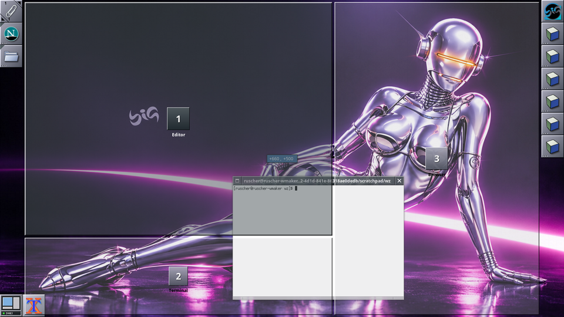

<p align="center">
  
</p>

<h1 align="center">wmake-zones</h1>

<p align="center">
  <b>Zonas de encaixe e mosaico de janelas para o Window Maker e o wlmaker.</b><br>
  Flutuante primeiro, mosaico quando você quiser.
</p>

<p align="center">
  
</p>

O wmake-zones é o organizador de janelas do
[Big WindowMaker](https://github.com/big-windowmaker/big-wm). Ele não troca
o gerenciador de janelas: o Window Maker continua decorando, focando e
empilhando no X11, e o wlmaker continua sendo o compositor no Wayland. O
wmake-zones só decide **onde** as janelas ficam, e só quando o usuário pede.

- **Zonas.** Ao arrastar uma janela, as regiões do layout aparecem como
  painéis do OpenStep; soltar encaixa a janela na zona. Perto da fronteira
  entre duas zonas, o alvo é a união das duas. **Esc** durante o arrasto
  cancela e devolve a janela. Uma janela encaixada arrastada para fora volta
  ao tamanho de antes.
- **Mosaico automático.** Principal + pilha, grade, colunas, linhas,
  monóculo, BSP, subdivisão e espiral. Arrastar uma janela do mosaico sobre
  outra troca as duas; redimensionar a principal muda a proporção.
- **Teclado.** Super+Z abre o seletor (1–9, setas, Tab troca o layout);
  Super+Ctrl+setas move a janela entre zonas e monitores.
- **Editor visual** de layouts, no feitio do WPrefs, com desfazer/refazer,
  importação e exportação.
- **Dockapp** no Dock/Clip, nos dois ambientes, com a miniatura do layout e
  o modo num LED.
- **Por monitor e área de trabalho:** layouts, mosaico e algoritmo próprios.
- **Regras por aplicativo:** flutuante, mosaico ou uma zona fixa.
- **Leve.** No X11, um processo de 0,7–2,7 MiB de PSS que não acorda em
  repouso; no Wayland, um módulo do próprio wlmaker.

O Window Maker tradicional continua sendo o padrão: **tudo vem desligado**.

## Capturas

| | |
|---|---|
|  |  |
| Sem compositor: contornos e o destino em listras | Wayland: o mesmo overlay, desenhado pelo wlmaker |
|  |  |
| Clique esquerdo no ladrilho: os layouts | Clique direito: o menu, como os do Window Maker |
|  |  |
| Preferências (seções como no WPrefs) | Editor de zonas |

## Uso

Ligar as zonas: *Áreas de trabalho > Organização de janelas*, o ladrilho
*Aparência > Dockapps > Organização de janelas*, as preferências
(`wmake-zones-prefs`) ou:

```sh
wmake-zones zones on          # liga e sobe o serviço (X11)
wmake-zones layout quarters   # metades, quadrantes, thirds, development...
wmake-zones autotile toggle
wmake-zones status
```

| Atalho | Ação |
|---|---|
| Super+Z | Escolher a zona da janela ativa (X11) |
| Super+Shift+Z | Ligar/desligar o mosaico automático |
| Super+Alt+Z | Editor de zonas |
| Super+Ctrl+Z | Próximo layout |
| Super+Ctrl+setas | Mover a janela para a zona ao lado (ou o monitor ao lado) |
| Super+Alt+setas | Focar a janela ao lado (X11) |
| Super+Shift+setas | Trocar de lugar no mosaico |
| Super+Ctrl+0 | Restaurar tamanho e posição |
| Super+Ctrl+F | Tirar do mosaico / devolver |
| Super+Ctrl+Enter | Tornar a janela principal |
| Super+Ctrl+= / − | Aumentar / diminuir a área principal |
| Super+Ctrl+Backspace | Desfazer a última organização (X11) |

Todos se trocam em *Preferências > Atalhos* (X11) ou no `Config.plist` do
wlmaker (ação `Zones`). Um atalho que outro programa já usa não é tomado e
aparece como conflito.

Recuperação: `wmake-zones --reset` desliga tudo e devolve o encaixe nas
bordas do próprio Window Maker (`WindowSnapping`), que fica desligado
enquanto as zonas estão ativas.

## Compilar

```sh
meson setup build
meson compile -C build
meson test -C build      # núcleo + testes funcionais (com Xvfb, wmaker, xdotool)
```

Dependências: libX11, libXi (XInput 2.1), libXrandr, libXext, libXft,
libXrender e fontconfig (serviço X11); GTK 3 (preferências); wayland-client e
cairo (dockapp do wlmaker). O núcleo (`libwmake-zones-engine.a`) não depende
de nada e é usado pelo wlmaker do Big WindowMaker
([patch 0104](https://github.com/big-windowmaker/packages/tree/main/wlmaker)).

## Documentação

[Arquitetura](docs/architecture.md) ·
[Backend X11](docs/x11-backend.md) ·
[Backend Wayland](docs/wayland-backend.md) ·
[Layouts](docs/layouts.md) ·
[Editor de zonas](docs/zones-editor.md) ·
[Mosaico](docs/auto-tiling.md) ·
[Monitores](docs/multi-monitor.md) ·
[Configuração](docs/configuration.md) ·
[Desempenho](docs/performance.md) ·
[Testes](docs/testing.md) ·
[Desenvolvimento](docs/development.md)

## Licença

GPL-2.0-or-later. O protocolo de ícones do wlmaker
(`src/wayland/protocols/`) é Apache-2.0, do projeto wlmaker.
