<p align="center">
  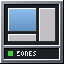
</p>

<h1 align="center">wmake-zones</h1>

<p align="center">
  <b>Zonas de encaixe e mosaico de janelas para o Window Maker e o wlmaker.</b><br>
  Flutuante primeiro, organizado quando você quiser.
</p>

<p align="center">
  <a href="https://github.com/big-windowmaker/wmake-zones/actions/workflows/ci.yml"></a>
  <a href="https://github.com/big-windowmaker/wmake-zones/tags"></a>
  
  
</p>

<p align="center">
  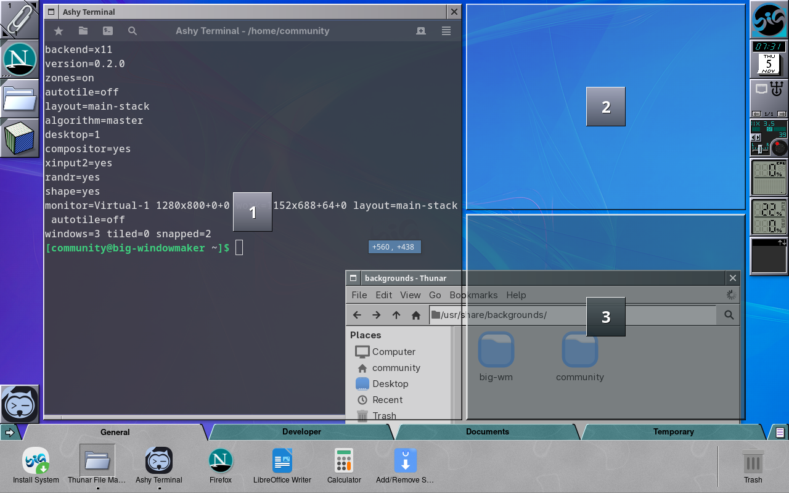
</p>

O wmake-zones é o organizador de janelas do
[Big WindowMaker](https://github.com/big-windowmaker/big-wm). Ele não troca o
gerenciador de janelas: no X11 o Window Maker continua decorando, focando e
empilhando, e no Wayland o wlmaker continua sendo o compositor. O
wmake-zones só decide **onde** as janelas ficam, e só quando você pede.

**As zonas vêm ligadas; o mosaico, não.** As janelas continuam flutuando
como no Window Maker tradicional e só mudam de lugar quando você as solta
numa zona. Um clique no ladrilho do Dock troca para o mosaico; o clique do
meio desliga tudo (e, desligado, nenhum processo fica rodando).

## O que ele faz

- **Primeiro o layout, depois a zona.** Ao arrastar uma janela, um painel
  no estilo dos menus do Window Maker mostra as miniaturas dos layouts.
  Pare o ponteiro sobre uma e as zonas dela aparecem no monitor; ou solte
  direto numa zona da miniatura. Tudo no mesmo arrasto.
- **Zonas ao arrastar.** As zonas aparecem como painéis chanfrados do
  OpenStep, translúcidos com o picom e em contorno sem ele. Perto da
  fronteira entre duas, o alvo é a união delas. **Esc** cancela e devolve a
  janela; uma janela encaixada arrastada para fora volta ao tamanho de
  antes.
- **Mosaico automático.** Principal + pilha, colunas, linhas, grade, BSP
  (árvore persistente), monóculo, espiral e subdivisão. Arrastar uma
  janela sobre outra troca as duas; puxar a borda da principal muda a
  proporção; desligar devolve cada janela ao lugar de antes. Janelas que
  não cabem e diálogos ficam flutuando.
- **Desfazer e refazer** qualquer organização: encaixes, trocas de layout
  e de modo, o mosaico, trocas de lugar, a proporção da principal.
- **Teclado:** Super+Z escolhe a zona, Super+Alt+setas foca a janela ao
  lado, Super+Ctrl+setas move entre zonas e monitores; todos se trocam.
- **Regras por aplicativo** pelo `app_id` (Wayland) ou pelo WM_CLASS
  (X11 e XWayland): sempre flutuante, sempre no mosaico, numa zona fixa,
  num monitor ou numa área de trabalho, ou fora de tudo.
- **Quinze layouts prontos**, de metades e terços a grades, ultrawide e
  retrato (o padrão vem do formato do monitor), e um **editor visual** no
  feitio do WPrefs para criar os seus.
- **Por monitor e por área de trabalho:** layout, mosaico e algoritmo
  próprios; cada monitor tem a sua área útil, sem cobrir Dock, Clip e o
  Dock com abas. Monitores conectados e desconectados são acompanhados.
- **Dockapp** no Dock: a tela mostra o modo de verdade (Zonas: as regiões
  do layout; Mosaico: as janelas na disposição do algoritmo; desligado: a
  pausa); embaixo, as setas ◀ ▶ trocam o layout ou o algoritmo e as teclas
  Z e M escolhem o modo (a acesa desliga). Clique esquerdo na tela alterna
  Zonas e Mosaico, o do meio desliga e religa, a roda troca o layout (ou o
  algoritmo, no Mosaico), o direito abre o menu.
- **O mesmo no X11 e no Wayland**: no Wayland, um módulo do próprio
  wlmaker, sem XWayland.
- **Leve:** no X11, um processo de 0,8 a 2,9 MiB que não acorda em repouso;
  no Wayland, um módulo do compositor.

<p align="center">
  <a href="#novidades-da-040">Novidades</a> ·
  <a href="#capturas">Capturas</a> ·
  <a href="#instalar">Instalar</a> ·
  <a href="#usar">Usar</a> ·
  <a href="#x11-e-wayland">X11 e Wayland</a> ·
  <a href="#compilar-e-testar">Compilar e testar</a> ·
  <a href="#contribuir">Contribuir</a> ·
  <a href="#créditos">Créditos</a> ·
  <a href="#in-english">English</a>
</p>

## Novidades da 0.4.0

Capturas de 12/11/2026, Window Maker real (X11) com a configuração do
Big WindowMaker.

| | |
|---|---|
| 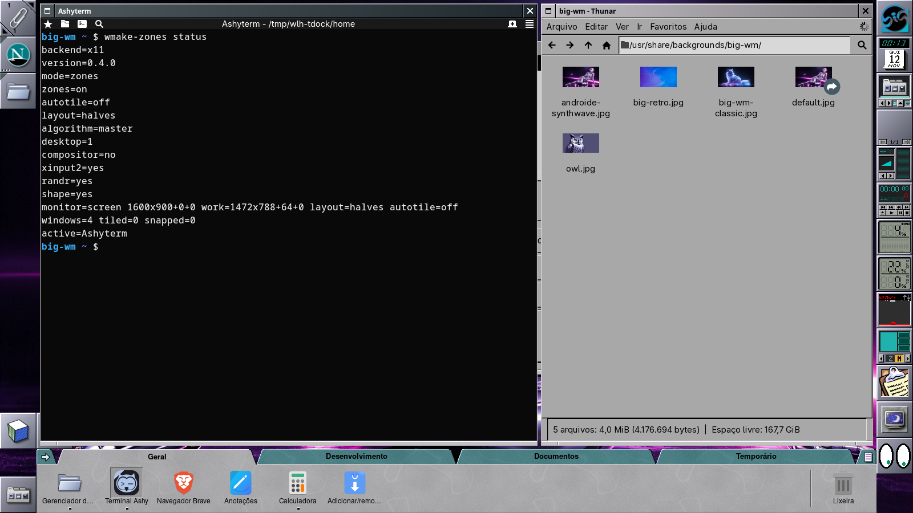 | 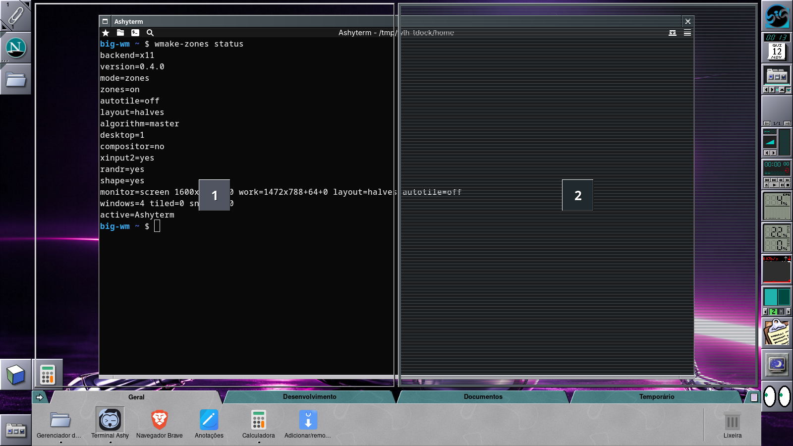 |
| Mosaico automático: as janelas se arrumam na área útil, sem cobrir o Dock | Seletor de zonas pelo teclado (Super+Z ou `wmake-zones picker`) |

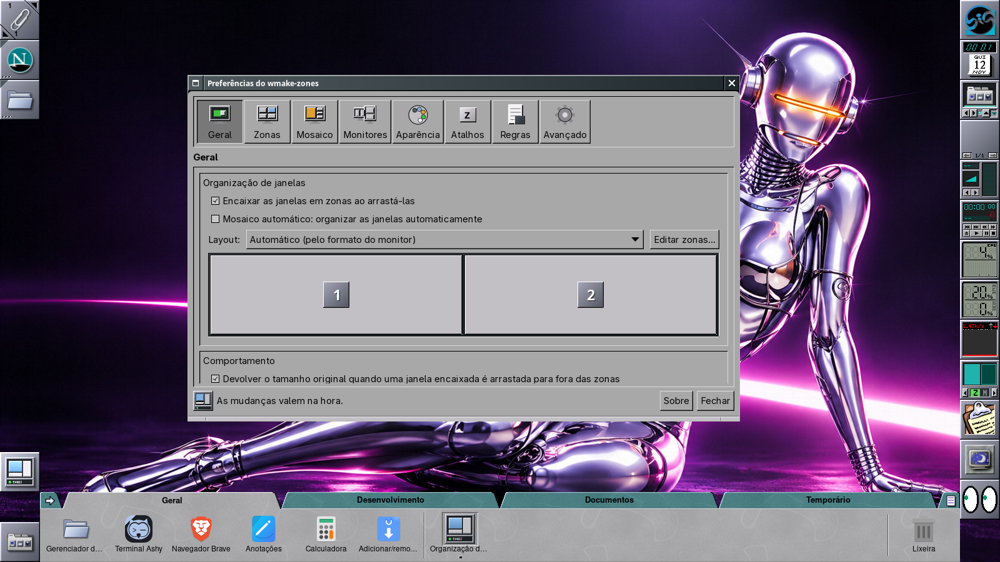

- **Mosaico com GTK4**: janelas que não cabem na célula (tamanho mínimo
  grande) trocam de lugar ou flutuam, e as Preferências mostram o motivo.
- **Dockapp no estilo LCD**, arrastável para o Dock e o Clip, com o menu
  do Window Maker; no Wayland, o ladrilho inteiro no tamanho configurado.
- **Tradução pt_BR revisada** com o vocabulário do Window Maker e o **Sobre**
  com os mantenedores e os agradecimentos.

## Capturas

O dockapp no modo Mosaico, um ladrilho por algoritmo (principal + pilha,
grade, colunas, linhas, monóculo, BSP, subdivisão, espiral), calculado na
área útil do monitor e reduzido:


Sessão real do Big WindowMaker numa VM (live ISO da Alpha, 0.3), com o tema padrão.

| | |
|---|---|
| 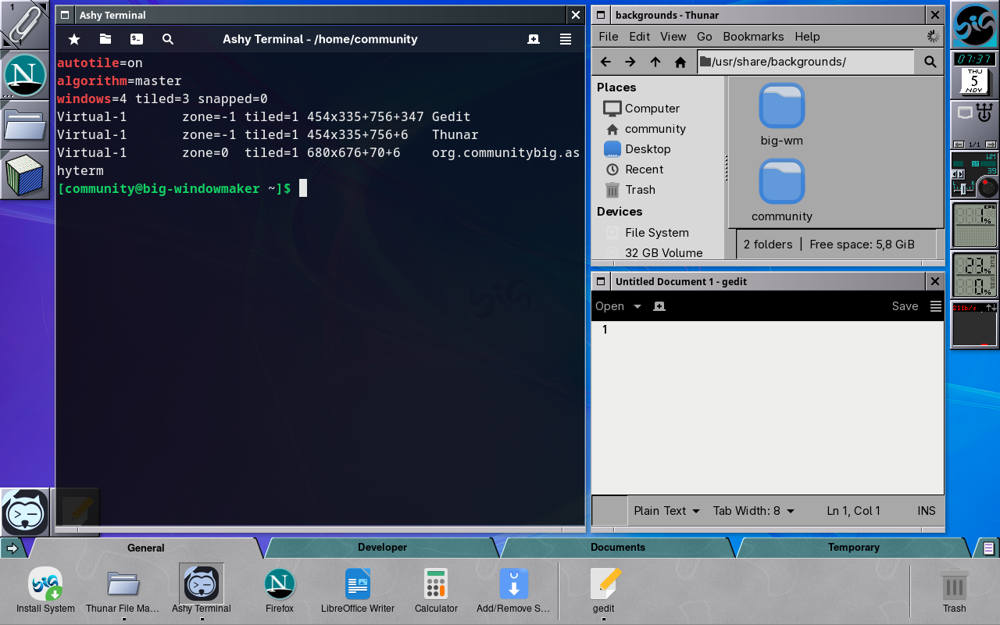 | 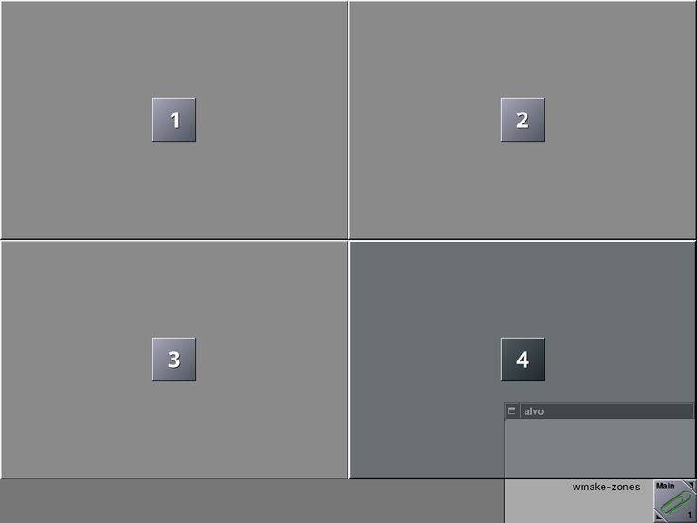 |
| Mosaico automático (X11) | Zonas no Wayland, desenhadas pelo wlmaker |
| 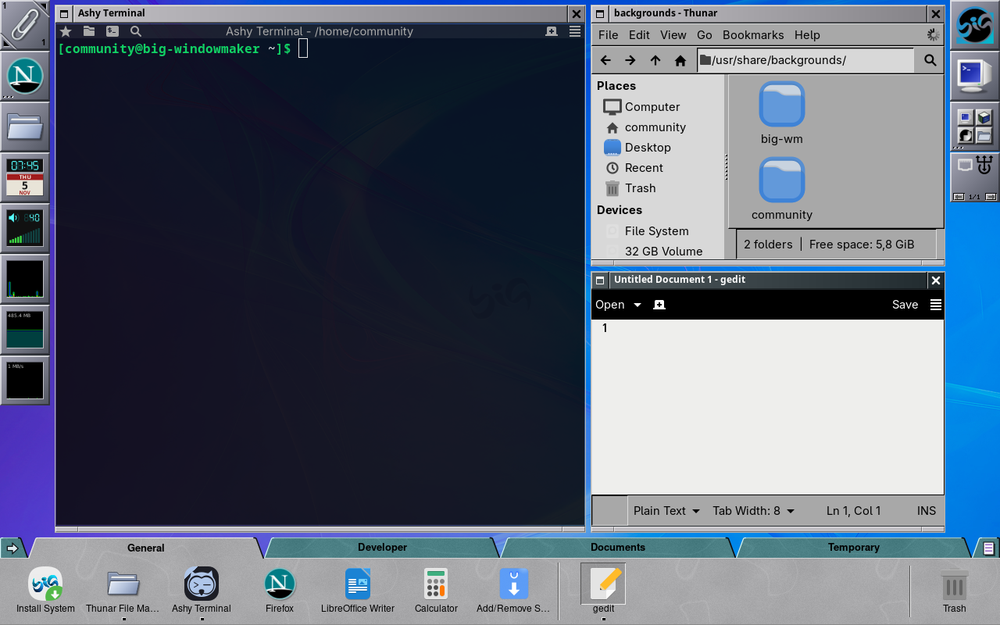 | 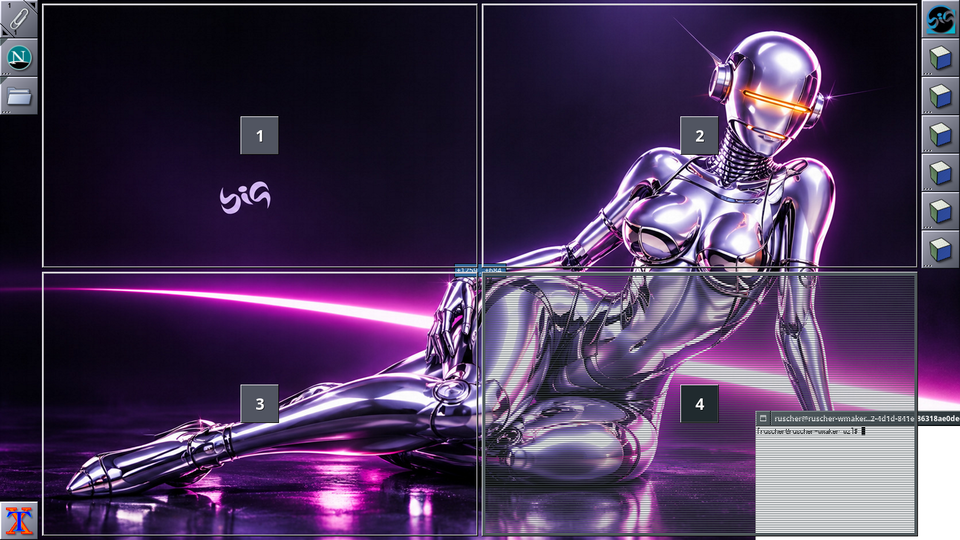 |
| Mosaico no Wayland: a mesma geometria do X11 | Sem compositor: contornos e o destino em listras |
| 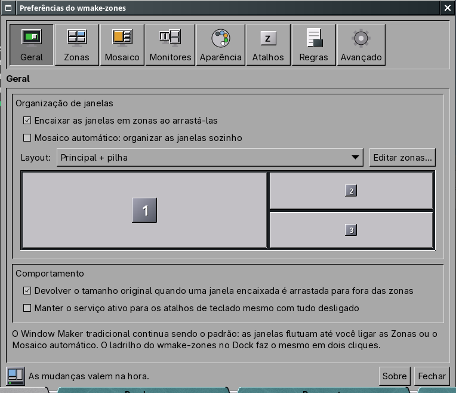 | 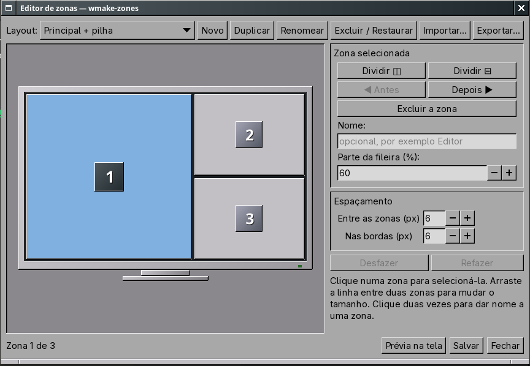 |
| Preferências, com as seções do WPrefs | Editor de zonas |
| 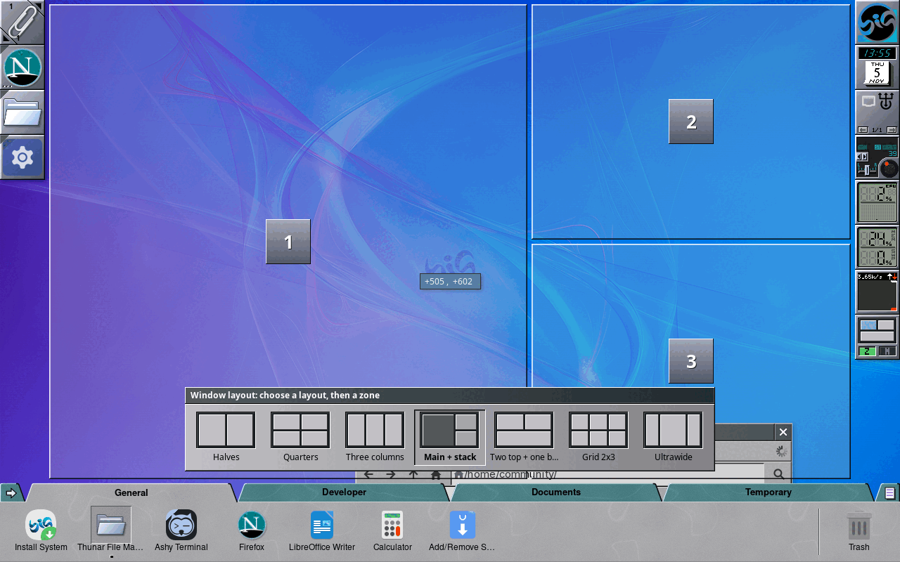 | 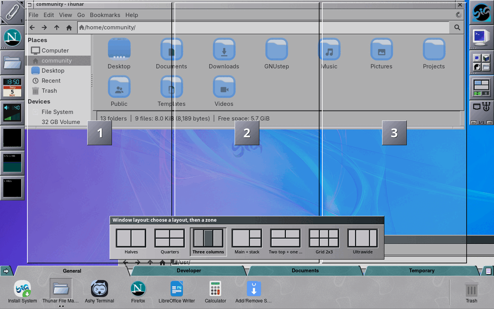 |
| Arrastar: primeiro o layout, depois a zona (X11) | O mesmo arrasto no Wayland |
| 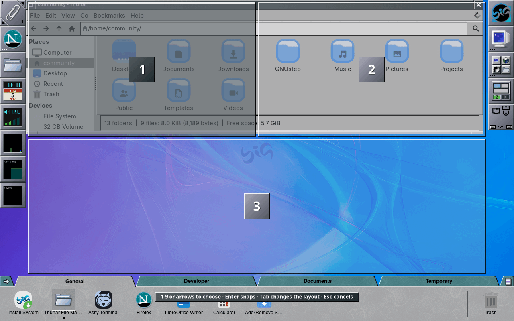 | 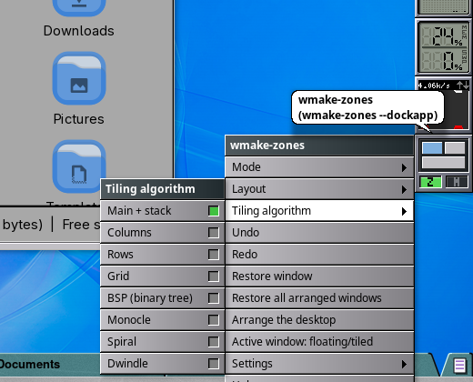 |
| Super+Z: escolher a zona pelo teclado (Wayland) | Clique direito no ladrilho: o menu, como os do Window Maker |
| 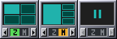 | 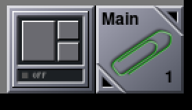 |
| O ladrilho no X11: Zonas, Mosaico e desligado; setas e teclas Z e M embaixo | O ladrilho nativo do wlmaker, igual |

## Instalar

No Big WindowMaker o pacote já vem na ISO e é dependência da sessão. Em
outra instalação Arch/Manjaro, pelo PKGBUILD de
[big-windowmaker/packages](https://github.com/big-windowmaker/packages/tree/main/wmake-zones):

```sh
git clone https://github.com/big-windowmaker/packages
cd packages/wmake-zones && makepkg -si
```

Direto deste repositório (Meson):

```sh
meson setup build --prefix=/usr
meson compile -C build
sudo meson install -C build
```

Dependências de execução: `gtk3`, `cairo`, `libx11`, `libxext`, `libxft`,
`libxi`, `libxinerama`, `libxrandr`, `libxrender`, `wayland`; de compilação:
`meson`, `wayland-protocols`, `librsvg`. Para remover: `sudo pacman -R
wmake-zones` (a configuração do usuário fica em `~/.config/wmake-zones/`).

Para as zonas no Wayland é preciso o `wlmaker` do mesmo repositório (patches
0104 a 0116), que liga no núcleo do wmake-zones.

## Usar

No Big WindowMaker tudo já vem pronto: as zonas ligadas e o ladrilho no
Dock. O resto se ajusta pelo ladrilho, por *Aparência > Organização de
janelas*, pelas preferências (`wmake-zones-prefs`) ou pelo terminal:

```sh
wmake-zones mode toggle         # Zonas <-> Mosaico (o clique esquerdo do ladrilho)
wmake-zones mode enable         # desliga / religa (o clique do meio)
wmake-zones zones on            # zonas ao arrastar (sobe o serviço no X11)
wmake-zones layout thirds       # halves, quarters, thirds, main-stack, grid-3x3...
wmake-zones autotile on         # mosaico automático
wmake-zones algorithm bsp       # master, columns, rows, grid, bsp, monocle, spiral, dwindle
wmake-zones status              # estado, monitores, áreas úteis e layouts
wmake-zones windows -l          # janelas: monitor, zona, mosaico, geometria e aplicativo
wmake-zones undo                # desfaz a última organização (redo refaz)
wmake-zones help                # todos os comandos
```

Os mesmos comandos valem no X11 e no Wayland: o cliente fala com o serviço
da sessão por um socket em `$XDG_RUNTIME_DIR/wmake-zones/`. A página de
manual (`man wmake-zones`) descreve todos.

### Atalhos

| Atalho | Ação |
|---|---|
| Super+Z | Escolher a zona da janela ativa (1–9, setas, Enter, Tab troca o layout) |
| Super+Shift+Z | Ligar/desligar o mosaico automático |
| Super+Alt+Z | Editor de zonas |
| Super+Ctrl+Z | Próximo layout |
| Super+Ctrl+setas | Mover a janela para a zona ao lado (ou o monitor ao lado) |
| Super+Alt+setas | Focar a janela ao lado |
| Super+Shift+setas | Trocar de lugar no mosaico |
| Super+Ctrl+0 | Restaurar tamanho e posição |
| Super+Ctrl+F | Tirar do mosaico / devolver |
| Super+Ctrl+Enter | Tornar a janela principal |
| Super+Ctrl+= / − | Aumentar / diminuir a área principal |
| Super+Ctrl+Backspace | Desfazer a última organização |
| Super+Ctrl+Shift+Backspace | Refazer |

Os atalhos se trocam em *Preferências > Atalhos* (X11) ou no `Config.plist`
do wlmaker (ação `Zones`). Um atalho que outro programa já usa não é tomado e
aparece como conflito no `status`.

### Configuração

Tudo se ajusta nas preferências; o arquivo é
`~/.config/wmake-zones/wmake-zones.conf` (INI, compatível com GKeyFile):

```ini
[General]
Zones=true
Layout=main-stack
Gap=6

# Um monitor com layout próprio
[Monitor HDMI-A-1]
Layout=ultrawide

# Mosaico só na área de trabalho 2
[Workspace 2]
Autotile=true

# Layout do usuário: árvore de divisões com pesos e nomes
[Layout estudo]
Name=Estudo
Tree=H(2"Leitura",1:V(1"Notas",1"Terminal"))

# Regra por aplicativo (app_id no Wayland, WM_CLASS no X11)
[Rule obs]
Class=com.obsproject.Studio
Action=float

# Ladrilho do Dock: o clique esquerdo mostra os layouts em vez de alternar
[Dockapp]
LeftClick=layouts
```

As mudanças feitas pelo serviço ou pelas preferências preservam comentários
e chaves desconhecidas, seguem links simbólicos (dotfiles) e são gravadas
atomicamente. O exemplo completo fica em
`/usr/share/doc/wmake-zones/wmake-zones.conf.example`.

### Voltar ao normal

`wmake-zones --reset` desliga tudo e devolve ao Window Maker o encaixe nas
bordas dele (`WindowSnapping`), que fica desligado enquanto as zonas estão
ativas.

## X11 e Wayland

| | X11 (Window Maker) | Wayland (wlmaker) |
|---|---|---|
| Primeiro o layout, depois a zona; zonas ao arrastar, Esc, união de zonas | ✅ | ✅ |
| Mosaico automático (8 algoritmos, BSP persistente), troca por arrasto | ✅ | ✅ |
| Proporção da principal pelo mouse | ✅ | ✅ |
| Seletor Super+Z, focar a janela ao lado, desfazer e refazer | ✅ | ✅ |
| Mover entre zonas e monitores pelo teclado | ✅ | ✅ |
| Regras por aplicativo | ✅ WM_CLASS | ✅ `app_id`; WM_CLASS no XWayland |
| Ativação só com modificador ou pela borda | ✅ | ✅ |
| Layouts por monitor e por área de trabalho | ✅ | ✅ |
| Dockapp: Zonas ↔ Mosaico, desligar, roda, menu | ✅ (`wmake-zones --dockapp`) | ✅ (`wmake-zones-wl`) |

Cada item foi conferido nos testes funcionais dos dois ambientes, com o
Window Maker e o wlmaker de verdade ([o que cada teste cobre](docs/testing.md)).

## Desempenho

Medido na 0.3.0 ([detalhes](docs/performance.md)), num Xvfb 1920×1080:

| | |
|---|---|
| Memória do serviço X11 (PSS) | 0,77 MiB em repouso; 2,93 MiB depois do primeiro overlay, estável |
| Repouso (10 s) | zero acordadas, zero tiques de CPU |
| Mosaico de 10 / 30 / 50 janelas | 2,5 / 5,2 / 6,6 ms |
| Painel de layouts / overlay das zonas | 2,9 / 11,4 ms |
| Encaixe (pedido ao Window Maker) | 25 µs |
| Valgrind (Memcheck), teste funcional inteiro | 0 erros, 0 bytes perdidos |

## Compilar e testar

```sh
meson setup build
meson compile -C build
meson test -C build                              # núcleo, metadados e X11 funcional
WLMAKER=/caminho/wlmaker tests/wayland-functional.sh build
```

Dependências: libX11, libXi (XInput 2.1), libXrandr, libXext, libXft,
libXrender e fontconfig (serviço X11); GTK 3 (preferências e editor);
wayland-client e cairo (dockapp do wlmaker). O núcleo
(`libwmake-zones-engine.a`) não depende de nada.

Os testes funcionais rodam o Window Maker e o wlmaker de verdade num Xvfb
próprio, nunca na sua tela: 931 mil verificações no núcleo, 52 no X11 e 45
no Wayland ([o que cada um cobre](docs/testing.md)).

## Documentação

[Arquitetura](docs/architecture.md) ·
[Backend X11](docs/x11-backend.md) ·
[Backend Wayland](docs/wayland-backend.md) ·
[Layouts](docs/layouts.md) ·
[Editor de zonas](docs/zones-editor.md) ·
[Mosaico](docs/auto-tiling.md) ·
[Monitores](docs/multi-monitor.md) ·
[Configuração](docs/configuration.md) ·
[Desempenho](docs/performance.md) ·
[Testes](docs/testing.md) ·
[Desenvolvimento](docs/development.md) ·
[Mudanças](CHANGELOG.md)

## Contribuir

- Problemas e ideias: [issues](https://github.com/big-windowmaker/wmake-zones/issues),
  com a sessão (X11 ou Wayland), o `wmake-zones status` e, se puder, uma captura.
- Código: um *pull request* por assunto, com `meson test -C build` passando
  e o teste de regressão do que foi corrigido; leia o
  [guia de contribuição](https://github.com/big-windowmaker/.github/blob/main/CONTRIBUTING.md).
- Tradução: `po/pt_BR.po` (o teste `po` confere o catálogo).

## Créditos

### Mantenedores do Big WindowMaker

- **Rafael Ruscher** — <rruscher@gmail.com>
- **Barnabé Di Kartola** — <barnabedikartola@gmail.com>

### Colaboradores

- **Rui Santana** ([@deleterium](https://github.com/deleterium)) — estilo LCD
  do dockapp, transparência do ícone e controles (#9).

### Agradecimentos especiais

- **Alfredo Kojima** — pelo desenvolvimento original do
  [Window Maker](https://www.windowmaker.org/) e pelo legado que inspirou
  este projeto.
- **Philipp Kaeser** — pelo [wlmaker](https://github.com/phkaeser/wlmaker) e
  pelo trabalho de levar a inspiração do Window Maker ao Wayland.
- **Bruno Gonçalves** — pelo [BigLinux](https://www.biglinux.com.br/) e por
  suas contribuições ao ecossistema Linux.
- **Tales A. Mendonça** — pelas contribuições ao desenvolvimento e
  fortalecimento da [BigCommunity](https://communitybig.org).

## Licença

GPL-2.0-or-later. O protocolo de ícones do wlmaker
(`src/wayland/protocols/`) é Apache-2.0, do projeto wlmaker. Os metadados
AppStream são CC0-1.0.

## In English

**wmake-zones** adds snap zones and automatic tiling to
[Big WindowMaker](https://github.com/big-windowmaker/big-wm), on X11 with
Window Maker and on Wayland with wlmaker, without replacing the window
manager: windows keep floating until you drop them on a zone, and tiling is
one click away on the Dock tile. Install from
[big-windowmaker/packages](https://github.com/big-windowmaker/packages)
(`makepkg -si` in `wmake-zones/`) or build with Meson; `wmake-zones help`
lists every command. Maintainers: Rafael Ruscher and Barnabé Di Kartola.
Special thanks to Alfredo Kojima (Window Maker), Philipp Kaeser (wlmaker),
Bruno Gonçalves (BigLinux) and Tales A. Mendonça (BigCommunity).
License: GPL-2.0-or-later.
