<p align="center">
  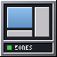
</p>

<h1 align="center">wmake-zones</h1>

<p align="center">
  <b>Zonas, mosaico e rolagem de janelas para o Window Maker e o wlmaker.</b><br>
  Flutuante primeiro, organizado quando você quiser.
</p>

<p align="center">
  <a href="https://github.com/big-windowmaker/wmake-zones/actions/workflows/ci.yml"></a>
  <a href="https://github.com/big-windowmaker/wmake-zones/tags"></a>
  
  
</p>

<p align="center">
  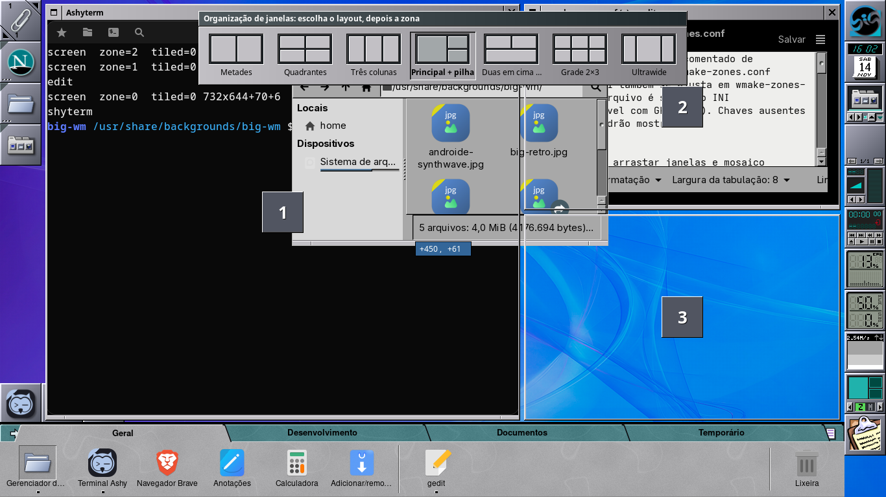
</p>
<p align="center"><sub>Arrastar uma janela no X11: primeiro o layout (o painel no alto), depois a zona (os números na tela).</sub></p>

O wmake-zones é o organizador de janelas do
[Big WindowMaker](https://github.com/big-windowmaker/big-wm). Ele não troca o
gerenciador de janelas: no X11 o Window Maker continua decorando, focando e
empilhando, e no Wayland o wlmaker continua sendo o compositor. O
wmake-zones só decide **onde** as janelas ficam, e só quando você pede.

**Três modos, uma tecla para cada no ladrilho do Dock:** **Z**onas
(organizar à mão, soltando a janela numa região), **M**osaico (organização
automática) e **R**olagem (uma faixa de colunas mais larga que a tela, como
no niri). As zonas vêm ligadas: as janelas continuam flutuando como no
Window Maker tradicional e só mudam de lugar quando você as solta numa
zona. **Cada modo lembra a própria organização**: trocar de modo e voltar
põe cada janela onde estava. O clique do meio desliga tudo (e, desligado,
nenhum processo fica rodando no X11).

## Sumário

- [Recursos](#recursos)
- [Capturas](#capturas)
- [X11 e Wayland](#x11-e-wayland)
- [Instalar](#instalar)
- [Usar](#usar) · [Comandos](#comandos) · [Atalhos](#atalhos) · [Dockapp](#dockapp) · [Configuração](#configuração)
- [Desempenho](#desempenho)
- [Compilar e testar](#compilar-e-testar)
- [Documentação](#documentação)
- [Contribuir](#contribuir) · [Créditos](#créditos) · [Licença](#licença) · [English](#in-english)

## Recursos

| | |
|---|---|
| **Primeiro o layout, depois a zona** | Ao arrastar uma janela, um painel no estilo dos menus do Window Maker mostra as miniaturas dos layouts. Pare o ponteiro sobre uma e as zonas dela aparecem no monitor; ou solte direto numa zona da miniatura. Tudo no mesmo arrasto. |
| **Zonas ao arrastar** | Painéis chanfrados do OpenStep, translúcidos com um compositor e em contorno (o destino em listras) sem ele. Perto da fronteira entre duas zonas, o alvo é a união delas. **Esc** cancela e devolve a janela; uma janela encaixada arrastada para fora mantém o tamanho que você deu a ela (`RestoreSizeOnUnsnap` traz o comportamento antigo). |
| **Rolagem** | As janelas viram colunas de uma faixa mais larga que a tela; abrir uma janela acrescenta uma coluna ao lado da ativa **sem redimensionar as outras**. Colunas com várias janelas, larguras de 25% a 100%, centralizar, rolar sem mudar o foco, arrastar para reordenar. Só colunas inteiras aparecem: as outras esperam fora de todos os monitores, sem vazar para o vizinho, com ou sem compositor; focar uma delas (Alt+Tab, lista de janelas) rola até ela. |
| **Memória por modo** | Zonas, Mosaico, Rolagem e desligado guardam cada um a sua organização: posição, tamanho, zona, maximização, as colunas e a ordem da faixa. Z → M → R → Z devolve cada janela exatamente onde estava; janelas abertas no meio do caminho ganham um lugar sem desarrumar as outras. |
| **Ctrl+Alt + mouse** | Botão esquerdo move, direito redimensiona pelo canto mais perto, de **qualquer ponto** da janela, sem procurar a barra de título; o clique não chega ao aplicativo (não seleciona texto nem aperta botões). Com as zonas, o encaixe funciona como num arrasto pela barra; na Rolagem, reordena as colunas. |
| **Mosaico automático** | Oito algoritmos: principal + pilha, colunas, linhas, grade, BSP (árvore persistente), monóculo, espiral e subdivisão. Arrastar uma janela sobre outra troca as duas; puxar a borda da principal muda a proporção; desligar devolve cada janela ao lugar de antes. Janelas que não cabem na célula (tamanho mínimo grande, como em GTK4) e diálogos ficam flutuando, e as Preferências mostram o motivo. |
| **Desfazer e refazer** | Encaixes, trocas de layout e de modo, o mosaico, trocas de lugar e a proporção da principal (20 passos por padrão). |
| **Teclado** | Super+Z escolhe a zona, Super+Alt+setas foca a janela ao lado, Super+Ctrl+setas move entre zonas e monitores; [todos os atalhos](#atalhos) se trocam. |
| **Regras por aplicativo** | Pelo `app_id` (Wayland) ou pelo WM_CLASS (X11 e XWayland): sempre flutuante, sempre no mosaico, numa zona fixa, num monitor ou numa área de trabalho, ou fora de tudo. |
| **Quinze layouts prontos** | Metades, quadrantes, terços, principal + pilha, grades, 70/30, ultrawide, desenvolvimento, tela pequena e retrato. O padrão vem do formato do monitor (ultrawide a partir de 21:9, retrato em pé, metades no resto). Um **editor visual** no feitio do WPrefs cria os seus. |
| **Por monitor e por área de trabalho** | Layout, mosaico e algoritmo próprios. Cada monitor tem a sua área útil, sem cobrir o Dock, o Clip e o Dock com Abas; monitores conectados e desconectados são acompanhados. |
| **Dockapp** | O ladrilho do Dock mostra o modo de verdade (as zonas, as janelas do mosaico ou as colunas da faixa) e troca o modo com as teclas Z, M e R; a roda troca o layout, o algoritmo ou a coluna ([detalhes](#dockapp)). |
| **Leve** | No X11, um processo de 0,8 a 2,9 MiB que não acorda em repouso; no Wayland, um módulo do próprio wlmaker, sem XWayland. |

## Capturas

### Rolagem (0.5.0)

Capturas de 24/11/2026 numa VM com o Big WindowMaker instalado (1280×800,
sessão real), wmake-zones 0.5.0 e wlmaker -10.

| | |
|---|---|
| 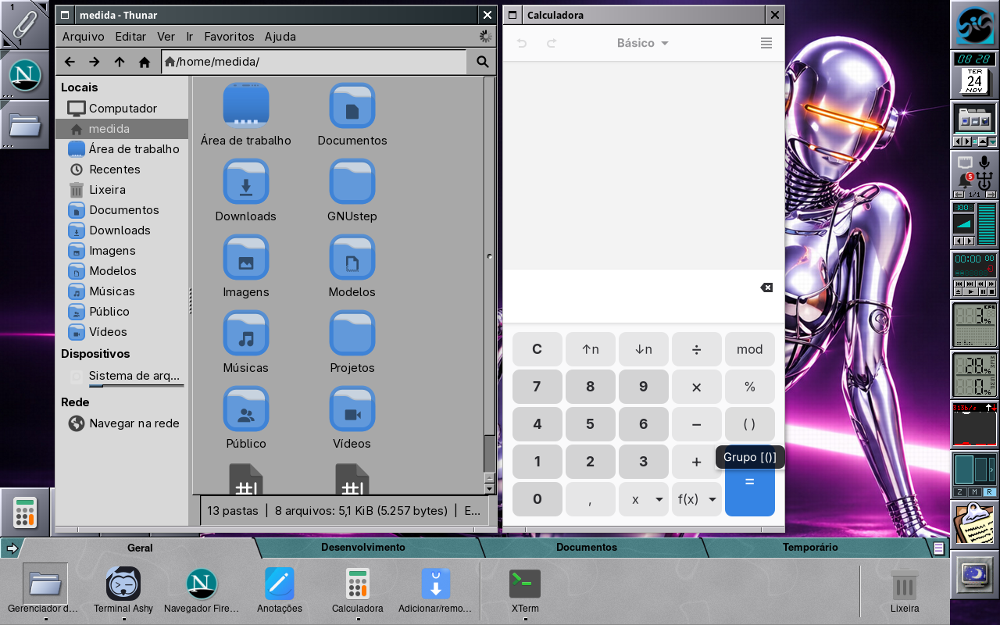 | 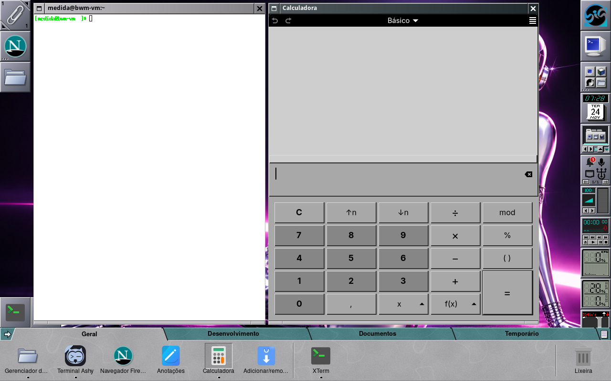 |
| X11: duas colunas na tela, duas esperando ao lado | Wayland: o mesmo dentro do wlmaker, com um xterm do XWayland |

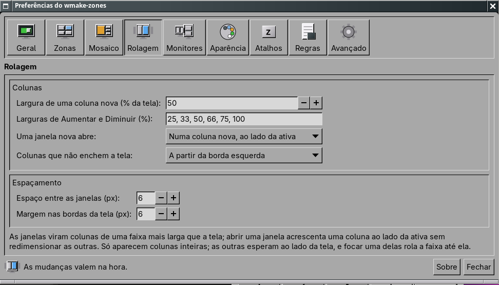

### 0.4.1

Capturas de 14/11/2026, wmake-zones 0.4.1 com a sessão do Big WindowMaker
(tema padrão, 1366×768), num servidor X próprio (Xvfb) com o Window Maker
ou com o wlmaker aninhado.

### X11 (Window Maker)

| | |
|---|---|
| 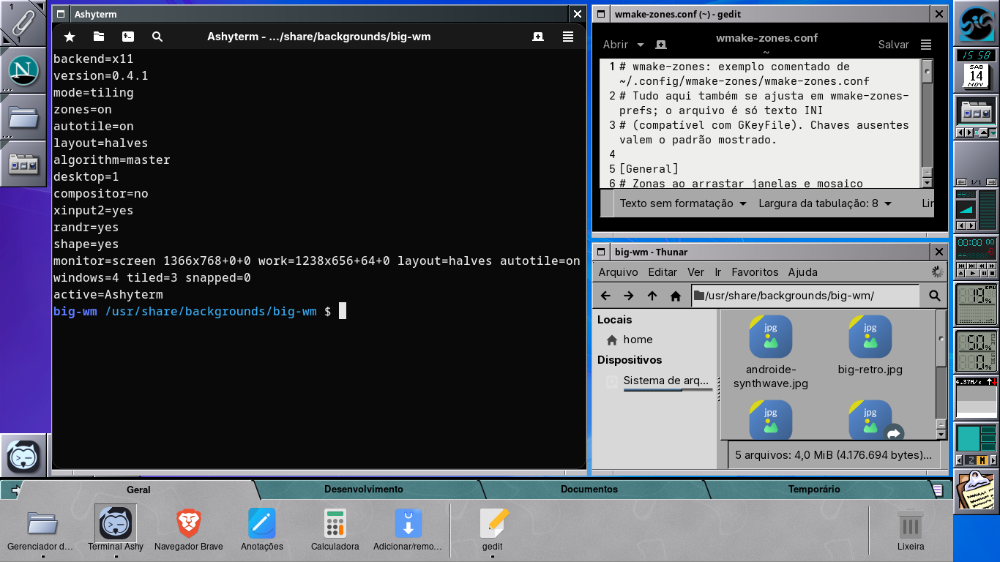 | 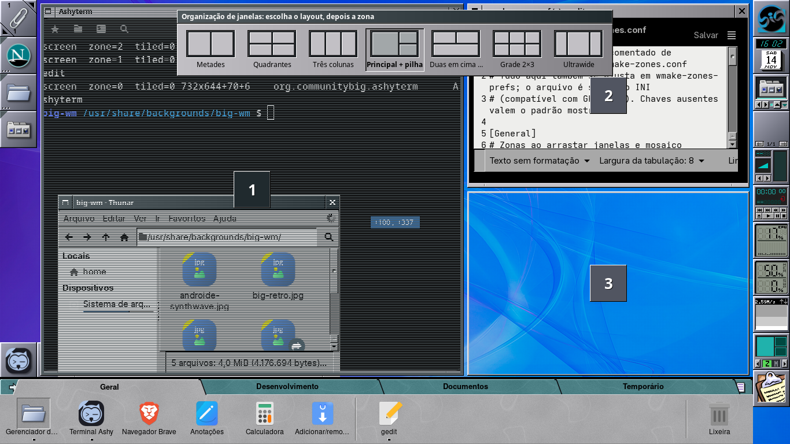 |
| Mosaico automático: principal + pilha na área útil, sem cobrir o Dock | Sem compositor: contornos, e o destino em listras |
| 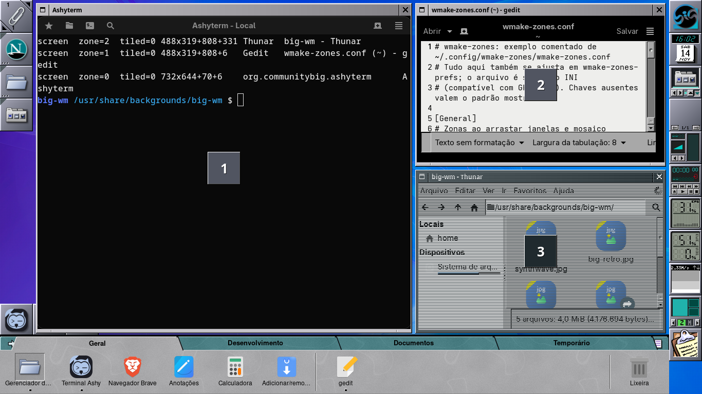 | 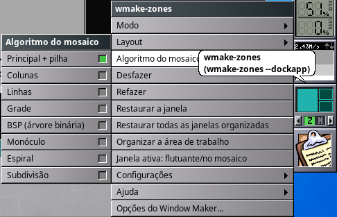 |
| Super+Z (ou `wmake-zones picker`): escolher a zona pelo teclado | Clique direito no ladrilho: modos, layout, algoritmo, desfazer e configurações |

### Wayland (wlmaker)

| | |
|---|---|
| 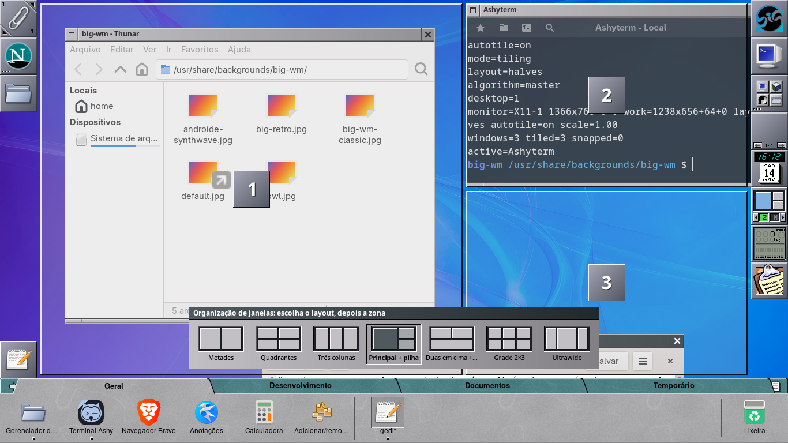 | 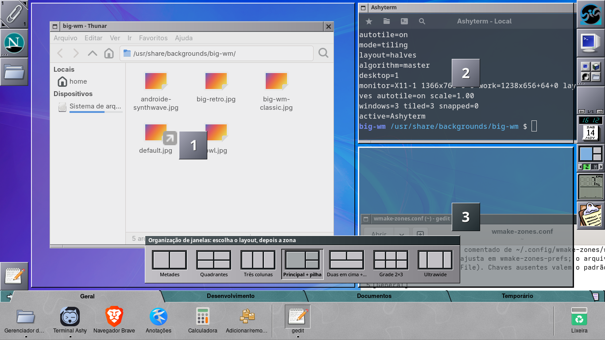 |
| O mesmo painel, desenhado pelo próprio compositor | Zonas translúcidas: o wlmaker não precisa de compositor à parte |
| 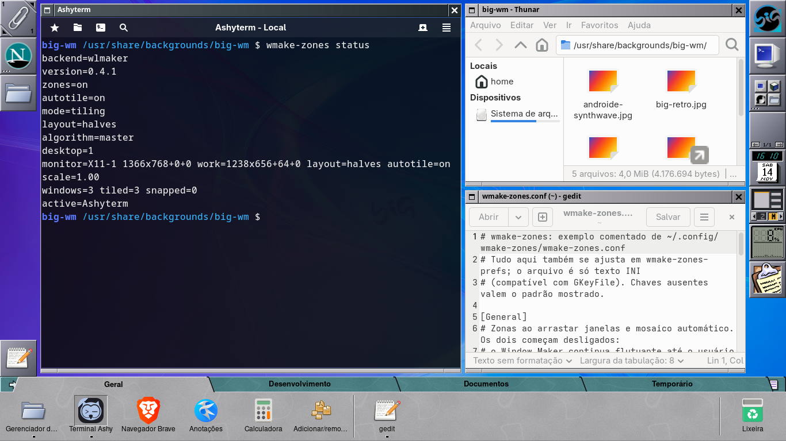 | 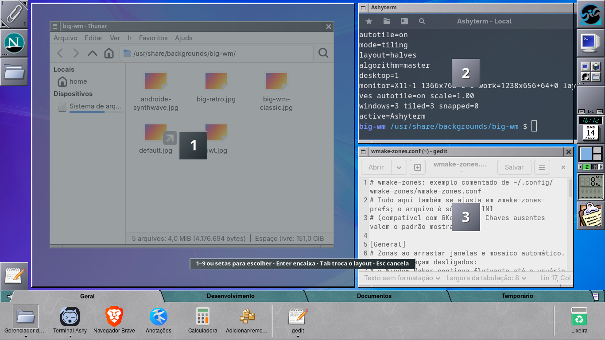 |
| Mosaico: as mesmas células do X11 | Seletor com a dica de teclado embaixo |

### Preferências e editor

| | |
|---|---|
| 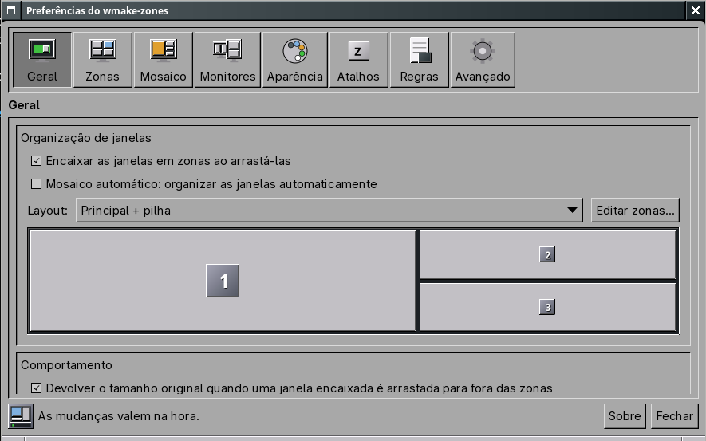 | 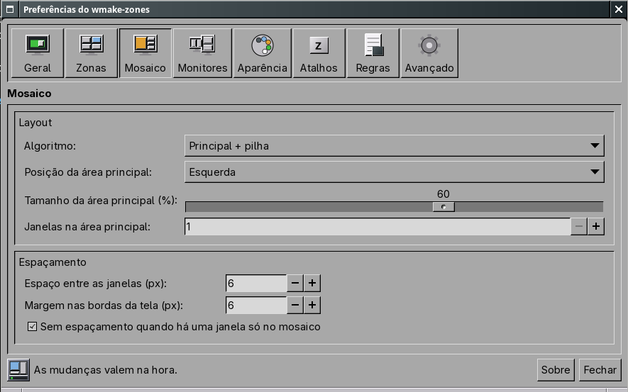 |
| `wmake-zones-prefs`: as seções do WPrefs (Geral, Zonas, Mosaico, Monitores, Aparência, Atalhos, Regras, Avançado) | Mosaico: algoritmo, área principal e espaçamento |

<p align="center">
  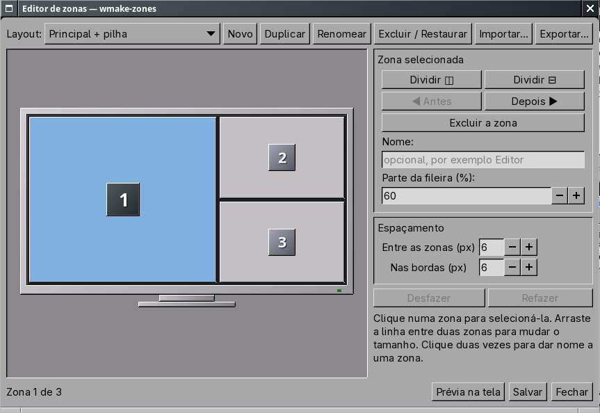
</p>
<p align="center"><sub>Editor de zonas (<code>wmake-zones-prefs --editor</code> ou Super+Alt+Z): dividir, mover a divisória, dar nome, importar e exportar.</sub></p>

## X11 e Wayland

O núcleo (`libwmake-zones-engine.a`: layouts, mosaico, histórico,
configuração) é o mesmo nos dois. Muda quem aplica a geometria: no X11, o
serviço `wmake-zones` pede ao Window Maker; no Wayland, o wlmaker do Big
WindowMaker liga no núcleo e faz tudo dentro do compositor.

| | X11 (Window Maker) | Wayland (wlmaker) |
|---|---|---|
| Quem organiza | serviço `wmake-zones` (sobe com as zonas ou o mosaico; desligado, sai) | o próprio wlmaker (patches do pacote `wlmaker`, a partir do 0104) |
| Primeiro o layout, depois a zona; Esc; união de zonas | ✅ | ✅ |
| Zonas translúcidas | com um compositor (picom); sem ele, contornos e listras | ✅ sempre (desenhadas pelo compositor) |
| Mosaico (8 algoritmos, BSP persistente), troca por arrasto, proporção pelo mouse | ✅ | ✅ |
| Seletor Super+Z, focar ao lado, desfazer e refazer | ✅ | ✅ (o seletor cede o teclado à tela de bloqueio) |
| Mover entre zonas e monitores pelo teclado | ✅ | ✅ |
| Regras por aplicativo | WM_CLASS | `app_id`; WM_CLASS no XWayland |
| Layouts por monitor e por área de trabalho | ✅ (monitores pelo RandR ou pelo Xinerama) | ✅ (com a escala de cada saída) |
| Atalhos | do serviço; trocam em *Preferências > Atalhos* | ação `Zones` no `Config.plist` do wlmaker |
| Dockapp | `wmake-zones --dockapp` | `wmake-zones-wl`, nativo, com o mesmo visual |
| Encaixe nas bordas do próprio WM | o `WindowSnapping` do Window Maker fica desligado enquanto as zonas estão ativas (`--reset` devolve) | — |

Os comandos do terminal são os mesmos nas duas sessões: o cliente fala com
quem organiza por um socket em `$XDG_RUNTIME_DIR/wmake-zones/`. Cada item
da tabela tem teste funcional com o Window Maker e o wlmaker de verdade
([o que cada teste cobre](docs/testing.md)).

## Instalar

No Big WindowMaker o pacote já vem na ISO e é dependência da sessão
(`big-wm-session`). Em outra instalação Arch/Manjaro, pelo PKGBUILD de
[big-windowmaker/packages](https://github.com/big-windowmaker/packages/tree/main/wmake-zones):

```sh
git clone https://github.com/big-windowmaker/packages
cd packages/wmake-zones && makepkg -si
```

| Pacote | Para quê |
|---|---|
| `libx11`, `libxi` (XInput 2.1), `libxrandr`, `libxinerama`, `libxext` (Shape), `libxrender`, `libxft`, `fontconfig` | serviço X11, overlay e dockapp |
| `gtk3`, `glib2` | preferências e editor (só enquanto abertos) |
| `wayland`, `cairo` | dockapp nativo do wlmaker |
| `hicolor-icon-theme` | ícones |
| `windowmaker` (opcional) | sessão X11; o `wdread`/`wdwrite` dele ligam e desligam o `WindowSnapping` |
| `wlmaker` do Big WindowMaker (opcional) | zonas e mosaico na sessão Wayland |
| `picom` (opcional) | zonas translúcidas no X11 |

Para compilar: `meson`, `wayland-protocols` e `librsvg` (ícones PNG do
Dock). Para remover: `sudo pacman -R wmake-zones`; a configuração do
usuário fica em `~/.config/wmake-zones/`.

## Usar

No Big WindowMaker tudo já vem pronto: as zonas ligadas e o ladrilho no
Dock. O resto se ajusta pelo ladrilho, por *Aparência > Organização de
janelas*, pelas preferências (`wmake-zones-prefs`) ou pelo terminal.

### Comandos

```sh
wmake-zones mode toggle         # Zonas -> Mosaico -> Rolagem (o clique esquerdo do ladrilho)
wmake-zones mode scroll         # Rolagem (zones, tiling, off; sobe o serviço no X11)
wmake-zones mode enable         # desliga / religa o último modo (o clique do meio)
wmake-zones zones on            # zonas ao arrastar (sobe o serviço no X11)
wmake-zones layout thirds       # halves, quarters, thirds, main-stack, grid-3x3...
wmake-zones layouts             # os layouts disponíveis, com a árvore de cada um
wmake-zones autotile on         # mosaico automático
wmake-zones algorithm bsp       # master, columns, rows, grid, bsp, monocle, spiral, dwindle
wmake-zones snap 2              # a janela ativa na zona 2
wmake-zones picker              # escolher a zona pelo teclado (Super+Z)
wmake-zones status              # estado, monitores, áreas úteis e layouts
wmake-zones windows -l          # janelas: monitor, zona, mosaico, geometria e aplicativo
wmake-zones windows -d          # por que cada janela está (ou não) no mosaico
wmake-zones undo                # desfaz a última organização (redo refaz)
wmake-zones scroll first        # Rolagem: primeira coluna (last, left, right, center)
wmake-zones column width 33%    # Rolagem: largura da coluna ativa (+ e - andam no ciclo)
wmake-zones column merge        # Rolagem: junta à coluna da esquerda (split separa)
wmake-zones prefs               # preferências (editor abre o editor de zonas)
wmake-zones --reset             # desliga tudo e devolve o WindowSnapping ao Window Maker
wmake-zones help                # todos os comandos
```

A página de manual (`man wmake-zones`) descreve todos, inclusive `move`,
`swap`, `focus`, `restore`, `float`, `promote`, `grow`, `shrink`,
`arrange`, `preview` e `reload`.

### Atalhos

| Atalho | Ação |
|---|---|
| Super+Z | Escolher a zona da janela ativa (1–9, setas, Enter; Tab troca o layout) |
| Super+Shift+Z | Ligar/desligar o mosaico automático |
| Super+Shift+R | Rolagem |
| Super+Alt+Z | Editor de zonas |
| Super+Ctrl+Z | Próximo layout |
| Super+Ctrl+setas | Mover a janela para a zona ao lado (ou para o monitor ao lado) |
| Super+Alt+setas | Focar a janela ao lado (na Rolagem, a coluna ou a janela da coluna) |
| Super+Shift+setas | Trocar de lugar no mosaico (na Rolagem, mover a coluna) |
| Super+Ctrl+0 | Restaurar tamanho e posição |
| Super+Ctrl+F | Tirar do mosaico / devolver |
| Super+Ctrl+Enter | Tornar a janela principal |
| Super+Ctrl+= / − | Aumentar / diminuir a área principal (na Rolagem, a largura da coluna) |
| Super+Ctrl+Home / End | Rolagem: primeira / última coluna |
| Super+Ctrl+C | Rolagem: centralizar a coluna ativa |
| Super+Ctrl+[ / ] | Rolagem: juntar à coluna da esquerda / tirar a janela da coluna |
| Ctrl+Alt + arrastar | Mover (botão esquerdo) ou redimensionar (direito) de qualquer ponto da janela |
| Super+Ctrl+Backspace | Desfazer a última organização |
| Super+Ctrl+Shift+Backspace | Refazer |

No X11 os atalhos se trocam em *Preferências > Atalhos* (seção `[Keys]`
do arquivo; vazio desliga); no Wayland, no `Config.plist` do wlmaker (ação
`Zones`). Um atalho que outro programa já usa não é tomado e aparece como
conflito no `status`.

### Dockapp

<p align="center">
  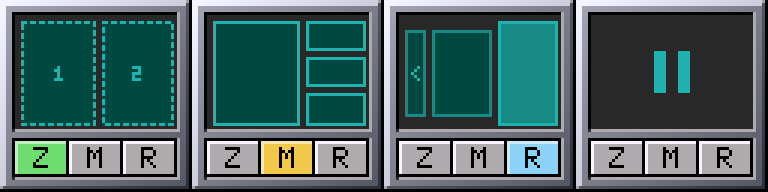
  <br>
  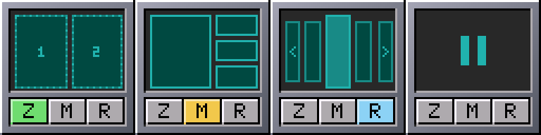
</p>
<p align="center"><sub>Em cima, o ladrilho do X11; embaixo, o do wlmaker. Zonas, Mosaico, Rolagem e desligado.</sub></p>

| Ação | Efeito |
|---|---|
| Clique esquerdo na tela | Zonas → Mosaico → Rolagem (`[Dockapp] LeftClick` muda) |
| Clique do meio | desliga e religa o último modo |
| Roda | troca o layout (Zonas), o algoritmo (Mosaico) ou a coluna em foco (Rolagem) |
| Teclas Z, M e R | escolhem o modo (Z verde, M amarelo, R azul-claro quando acesas); a acesa desliga |
| Clique direito | o menu: modos, layout, algoritmo, desfazer, refazer, restaurar, organizar, configurações |

No modo Mosaico a tela mostra as janelas na disposição do algoritmo do
monitor, calculada na área útil de verdade; um ladrilho por algoritmo:

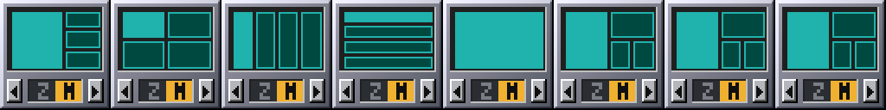

### Configuração

Tudo se ajusta nas preferências; o arquivo é
`~/.config/wmake-zones/wmake-zones.conf` (INI, compatível com GKeyFile):

```ini
[General]
Zones=true
Layout=main-stack
Gap=6

# Um monitor com layout próprio
[Monitor HDMI-A-1]
Layout=ultrawide

# Mosaico só na área de trabalho 2
[Workspace 2]
Autotile=true

# Layout do usuário: árvore de divisões com pesos e nomes
[Layout estudo]
Name=Estudo
Tree=H(2"Leitura",1:V(1"Notas",1"Terminal"))

# Regra por aplicativo (app_id no Wayland, WM_CLASS no X11)
[Rule obs]
Class=com.obsproject.Studio
Action=float

# Ladrilho do Dock: o clique esquerdo mostra os layouts em vez de alternar
[Dockapp]
LeftClick=layouts
```

As mudanças feitas pelo serviço ou pelas preferências preservam comentários
e chaves desconhecidas, seguem links simbólicos (dotfiles) e são gravadas
atomicamente. Todas as chaves e os padrões estão em
[Configuração](docs/configuration.md); o exemplo comentado fica em
`/usr/share/doc/wmake-zones/wmake-zones.conf.example`.

## Desempenho

Medido na 0.5.0 (`tests/perf-x11.sh`, Xvfb e o Window Maker de verdade, a
mesma máquina e a 0.4.1 para comparar; [detalhes](docs/performance.md)):

| | 0.4.1 | 0.5.0 |
|---|---|---|
| Memória do serviço X11 (PSS) em repouso | 0,79 MiB | 0,83 MiB |
| Depois do primeiro overlay e de 60 ciclos | 2,95 MiB, estável | 2,99 MiB, estável |
| Repouso (10 s) | zero acordadas, zero tiques | zero acordadas, zero tiques |
| Ligar o mosaico com 10 / 30 / 50 janelas | 1,4–3,1 / 5,1–5,8 / 7,5 ms | 5,0–6,4 / 6,7–8,3 / 10,3–12,8 ms |
| Overlay das zonas / painel de layouts | 12,9–13,5 / 2,8–3,2 ms | 12,1–12,4 / 2,9–3,4 ms |
| Encaixe (pedido ao Window Maker) | 23–27 µs | 20–22 µs |

Ligar o mosaico custa alguns milissegundos a mais porque cada janela guarda
a memória do modo livre (posição, zona e maximização) na hora: uma vez por
troca de modo, sempre abaixo de um quadro de 16 ms. ASan e UBSan limpos nos
testes do X11 e do Wayland.

## Compilar e testar

```sh
meson setup build
meson compile -C build
meson test -C build                              # tudo; o Wayland pula sem o wlmaker das zonas
WLMAKER=/caminho/wlmaker meson test -C build --suite wayland
```

A suíte `wayland` usa o cliente `wmake-zones`, que só existe com o X11:
num build com `-Dx11=disabled` ela não tem nenhum teste, mesmo com o
`WLMAKER` certo.

| Opção do Meson | Padrão | |
|---|---|---|
| `x11` | auto | serviço X11 e dockapp do Window Maker |
| `prefs` | auto | preferências e editor (GTK 3) |
| `wayland_dockapp` | auto | dockapp nativo do wlmaker |
| `engine_lib` | true | instala o núcleo estático e o `.pc` para o wlmaker |
| `nls`, `tests` | true | traduções e testes |

Os testes funcionais sobem o Window Maker e o wlmaker de verdade num Xvfb
próprio, nunca na sua tela, e pulam (SKIP) sem as ferramentas:

| Teste | Verificações | O que cobre |
|---|---|---|
| `engine` | 931 mil | layouts, mosaico, foco espacial, histórico e INI; também com sanitizers no CI |
| `x11-functional` | 52 | arrasto, Esc, painel de layouts, seletor, mosaico, regras, repouso e PSS |
| `x11-multimonitor` | 13 | dois heads no Xephyr (`+xinerama`): mosaico por monitor, Dock que aparece e some |
| `x11-dockapp` (e `-noshape`) | 27 | modos pelos pixels, teclas Z, M e R e as bordas delas, menu e arrasto para o Dock |
| `wayland-functional` | 51 | o mesmo no wlmaker aninhado, com janelas GTK nativas |
| `metainfo`, `po` | — | AppStream (`appstreamcli`) e catálogos de tradução |

Para os testes: `xorg-server-xvfb`, `xorg-server-xephyr`, `windowmaker`,
`xdotool`, `xorg-xprop`, `xorg-xwininfo`, `xterm`, `imagemagick`,
`python-gobject`, `python-xlib`, `python-pillow`, `appstream` e `gettext`
(sem o `xgettext`, o `msgcmp` e o `msgfmt`, o teste `po` pula). Detalhes em
[Testes](docs/testing.md).

## Documentação

[Arquitetura](docs/architecture.md) ·
[Backend X11](docs/x11-backend.md) ·
[Backend Wayland](docs/wayland-backend.md) ·
[Layouts](docs/layouts.md) ·
[Editor de zonas](docs/zones-editor.md) ·
[Mosaico](docs/auto-tiling.md) ·
[Monitores](docs/multi-monitor.md) ·
[Configuração](docs/configuration.md) ·
[Desempenho](docs/performance.md) ·
[Rolagem (desenvolvimento)](docs/scrollable-tiling/README.md) ·
[Testes](docs/testing.md) ·
[Desenvolvimento](docs/development.md) ·
[Mudanças](CHANGELOG.md)

## Contribuir

- Problemas e ideias: [issues](https://github.com/big-windowmaker/wmake-zones/issues),
  com a sessão (X11 ou Wayland), o `wmake-zones status` e, se puder, uma captura.
- Código: um *pull request* por assunto, com `meson test -C build` passando
  e o teste de regressão do que foi corrigido; leia o
  [guia de contribuição](https://github.com/big-windowmaker/.github/blob/main/CONTRIBUTING.md).
- Tradução: `po/pt_BR.po`, com o glossário em `po/glossary/pt_BR.tsv` (o
  teste `po` confere o catálogo).

## Créditos

### Mantenedores do Big WindowMaker

- **Rafael Ruscher** — <rruscher@gmail.com>
- **Barnabé Di Kartola** — <barnabedikartola@gmail.com>

### Colaboradores

- **Rui Santana** ([@deleterium](https://github.com/deleterium)) — estilo LCD
  do dockapp, transparência do ícone e controles (#9).

### Agradecimentos especiais

- **Alfredo Kojima** — pelo desenvolvimento original do
  [Window Maker](https://www.windowmaker.org/) e pelo legado que inspirou
  este projeto.
- **Philipp Kaeser** — pelo [wlmaker](https://github.com/phkaeser/wlmaker) e
  pelo trabalho de levar a inspiração do Window Maker ao Wayland.
- **Bruno Gonçalves** — pelo [BigLinux](https://www.biglinux.com.br/) e por
  suas contribuições ao ecossistema Linux.
- **Tales A. Mendonça** — pelas contribuições ao desenvolvimento e
  fortalecimento da [BigCommunity](https://communitybig.org).
- **[niri](https://github.com/niri-wm/niri)** (Ivan Molodetskikh e
  colaboradores) — a referência de comportamento da Rolagem (scrollable
  tiling). Nenhum código do niri é usado: a Rolagem do wmake-zones foi
  escrita do zero em C, sobre o núcleo comum do X11 e do wlmaker.

## Licença

GPL-2.0-or-later. O protocolo de ícones do wlmaker
(`src/wayland/protocols/`) é Apache-2.0, do projeto wlmaker. Os metadados
AppStream são CC0-1.0.

## In English

**wmake-zones** adds snap zones, automatic tiling and scrollable tiling (a
strip of columns wider than the screen, as in niri, written from scratch in
C) to
[Big WindowMaker](https://github.com/big-windowmaker/big-wm), on X11 with
Window Maker and on Wayland with wlmaker, without replacing the window
manager: windows keep floating until you drop them on a zone, and tiling is
one click away on the Dock tile. Each mode remembers its own arrangement,
and Ctrl+Alt + left or right button moves or resizes a window from anywhere
in it. Install from
[big-windowmaker/packages](https://github.com/big-windowmaker/packages)
(`makepkg -si` in `wmake-zones/`) or build with Meson; `wmake-zones help`
lists every command. Maintainers: Rafael Ruscher and Barnabé Di Kartola.
Special thanks to Alfredo Kojima (Window Maker), Philipp Kaeser (wlmaker),
Bruno Gonçalves (BigLinux) and Tales A. Mendonça (BigCommunity).
License: GPL-2.0-or-later.
