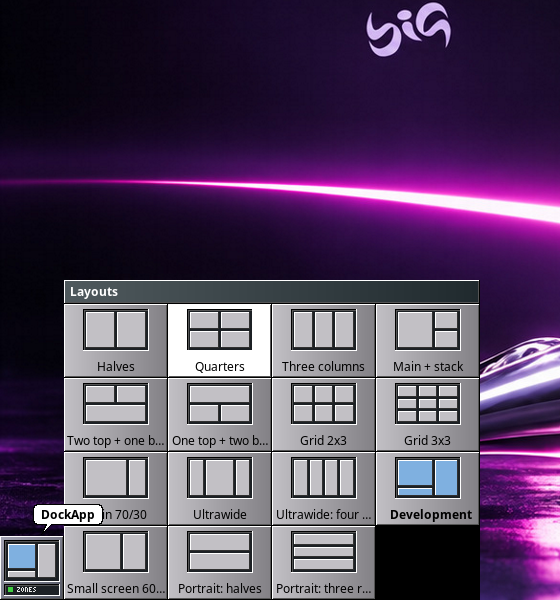

<p align="center">
  
</p>

<h1 align="center">wmake-zones</h1>

<p align="center">
  <b>Zonas de encaixe e mosaico de janelas para o Window Maker e o wlmaker.</b><br>
  Flutuante primeiro, organizado quando você quiser.
</p>

<p align="center">
  <a href="https://github.com/big-windowmaker/wmake-zones/releases"></a>
  
  
</p>

<p align="center">
  
</p>

O wmake-zones é o organizador de janelas do
[Big WindowMaker](https://github.com/big-windowmaker/big-wm). Ele não troca o
gerenciador de janelas: no X11 o Window Maker continua decorando, focando e
empilhando, e no Wayland o wlmaker continua sendo o compositor. O
wmake-zones só decide **onde** as janelas ficam, e só quando você pede.

**Tudo vem desligado.** O Window Maker tradicional, flutuante, continua sendo o
padrão; com as zonas e o mosaico desligados, nenhum processo fica rodando.

## O que ele faz

- **Zonas ao arrastar.** As zonas do layout aparecem como painéis
  chanfrados do OpenStep, translúcidos com o picom e em contorno sem ele.
  Soltar a janela encaixa na zona; perto da fronteira entre duas, o alvo é a
  união delas. **Esc** durante o arrasto cancela e devolve a janela, e uma
  janela encaixada arrastada para fora volta ao tamanho de antes.
- **Mosaico automático.** Principal + pilha, colunas, linhas, grade, BSP,
  monóculo, espiral e subdivisão (*dwindle*). Arrastar uma janela do mosaico
  sobre outra troca as duas; puxar a borda da principal muda a proporção;
  desligar devolve cada janela ao lugar de antes. Janelas que não cabem
  (tamanho mínimo grande, como uma calculadora) ficam flutuando, uma por vez,
  sem tirar as outras.
- **Quinze layouts prontos**, de metades e terços a grades, ultrawide e
  retrato, e um **editor visual** no feitio do WPrefs para criar os seus.
- **Por monitor e por área de trabalho:** layout, mosaico e algoritmo
  próprios; cada monitor tem a sua área útil, sem cobrir Dock, Clip e o Dock
  com abas.
- **Teclado:** Super+Z escolhe a zona (X11), Super+Ctrl+setas move entre
  zonas e monitores, e todos os atalhos se trocam nas preferências.
- **Regras por aplicativo** (X11): sempre flutuante, sempre no mosaico ou
  numa zona fixa.
- **Dockapp** para o Dock ou o Clip, nos dois ambientes, com a miniatura do
  layout e o modo num LED.
- **Leve:** no X11, um processo de 0,7 a 2,8 MiB que não acorda em repouso;
  no Wayland, um módulo do próprio wlmaker (+48 KiB).

## Capturas

Sessão real do Big WindowMaker numa VM (live ISO), com o tema padrão.

| | |
|---|---|
|  |  |
| Mosaico automático (X11) | Zonas no Wayland, desenhadas pelo wlmaker |
|  |  |
| Mosaico no Wayland: a mesma geometria do X11 | Sem compositor: contornos e o destino em listras |
|  |  |
| Preferências, com as seções do WPrefs | Editor de zonas |
|  |  |
| Clique esquerdo no ladrilho: os layouts | Clique direito: o menu, como os do Window Maker |
|  |  |
| O ladrilho no X11: layout e modo no LED | O ladrilho nativo do wlmaker, ao lado do Clip |

## Instalar

No Big WindowMaker o pacote já vem na ISO e é dependência da sessão. Em
outra instalação Arch/Manjaro, pelo PKGBUILD de
[big-windowmaker/packages](https://github.com/big-windowmaker/packages/tree/main/wmake-zones):

```sh
git clone https://github.com/big-windowmaker/packages
cd packages/wmake-zones && makepkg -si
```

Para as zonas no Wayland é preciso o `wlmaker` do mesmo repositório (patches
0104 a 0109), que liga no núcleo do wmake-zones.

## Usar

Ligue as zonas por *Área de trabalho > Organização de janelas*, pelo
ladrilho em *Aparência > Dockapps > Organização de janelas*, pelas
preferências (`wmake-zones-prefs`) ou pelo terminal:

```sh
wmake-zones zones on            # zonas ao arrastar (sobe o serviço no X11)
wmake-zones layout thirds       # halves, quarters, thirds, main-stack, grid-3x3...
wmake-zones autotile on         # mosaico automático
wmake-zones algorithm bsp       # master, columns, rows, grid, bsp, monocle, spiral, dwindle
wmake-zones status              # estado, monitores, áreas úteis e layouts
wmake-zones windows -l          # janelas: monitor, zona, mosaico e geometria
wmake-zones help                # todos os comandos
```

Os mesmos comandos valem no X11 e no Wayland: o cliente fala com o serviço
da sessão por um socket em `$XDG_RUNTIME_DIR/wmake-zones/`. A página de
manual (`man wmake-zones`) descreve todos.

### Atalhos

| Atalho | Ação |
|---|---|
| Super+Z | Escolher a zona da janela ativa (1–9, setas, Enter; X11) |
| Super+Shift+Z | Ligar/desligar o mosaico automático |
| Super+Alt+Z | Editor de zonas |
| Super+Ctrl+Z | Próximo layout |
| Super+Ctrl+setas | Mover a janela para a zona ao lado (ou o monitor ao lado) |
| Super+Alt+setas | Focar a janela ao lado (X11) |
| Super+Shift+setas | Trocar de lugar no mosaico |
| Super+Ctrl+0 | Restaurar tamanho e posição |
| Super+Ctrl+F | Tirar do mosaico / devolver |
| Super+Ctrl+Enter | Tornar a janela principal |
| Super+Ctrl+= / − | Aumentar / diminuir a área principal |
| Super+Ctrl+Backspace | Desfazer a última organização (X11) |

Os atalhos se trocam em *Preferências > Atalhos* (X11) ou no `Config.plist`
do wlmaker (ação `Zones`). Um atalho que outro programa já usa não é tomado e
aparece como conflito no `status`.

### Configuração

Tudo se ajusta nas preferências; o arquivo é
`~/.config/wmake-zones/wmake-zones.conf` (INI, compatível com GKeyFile):

```ini
[General]
Zones=true
Layout=main-stack
Gap=6

# Um monitor com layout próprio
[Monitor HDMI-A-1]
Layout=ultrawide

# Mosaico só na área de trabalho 2
[Workspace 2]
Autotile=true

# Layout do usuário: árvore de divisões com pesos e nomes
[Layout estudo]
Name=Estudo
Tree=H(2"Leitura",1:V(1"Notas",1"Terminal"))

# Regra por aplicativo (X11)
[Rule obs]
Class=obs
Action=float
```

As mudanças feitas pelo serviço ou pelas preferências preservam comentários
e chaves desconhecidas, seguem links simbólicos (dotfiles) e são gravadas
atomicamente. O exemplo completo fica em
`/usr/share/doc/wmake-zones/wmake-zones.conf.example`.

### Voltar ao normal

`wmake-zones --reset` desliga tudo e devolve ao Window Maker o encaixe nas
bordas dele (`WindowSnapping`), que fica desligado enquanto as zonas estão
ativas.

## X11 e Wayland

| | X11 (Window Maker) | Wayland (wlmaker) |
|---|---|---|
| Zonas ao arrastar, Esc, união de zonas, tamanho de antes | ✅ | ✅ |
| Mosaico automático (8 algoritmos), troca por arrasto | ✅ | ✅ |
| Mover entre zonas e monitores pelo teclado | ✅ | ✅ |
| Layouts por monitor e por área de trabalho | ✅ | ✅ |
| Dockapp | ✅ (`wmake-zones --dockapp`) | ✅ (`wmake-zones-wl`) |
| Seletor Super+Z, focar a janela ao lado, desfazer | ✅ | — |
| Regras por aplicativo, ativação só com modificador | ✅ | — (o wlmaker ainda não guarda o app_id) |
| Proporção da principal pelo mouse, BSP persistente | ✅ | — |

## Desempenho

Medido na 0.2.0 ([detalhes](docs/performance.md)), num Xvfb 1920×1080:

| | |
|---|---|
| Memória do serviço X11 (PSS) | 0,73 MiB em repouso; 2,79 MiB depois do primeiro overlay, estável |
| Repouso (10 s) | zero acordadas, zero tiques de CPU |
| Mosaico de 10 / 30 / 50 janelas | 2,6 / 5,5 / 5,2 ms |
| Encaixe (pedido ao Window Maker) | 34 µs |
| Módulo de zonas no wlmaker | +48 KiB |

## Compilar e testar

```sh
meson setup build
meson compile -C build
meson test -C build                              # núcleo, metadados e X11 funcional
WLMAKER=/caminho/wlmaker tests/wayland-functional.sh build
```

Dependências: libX11, libXi (XInput 2.1), libXrandr, libXext, libXft,
libXrender e fontconfig (serviço X11); GTK 3 (preferências e editor);
wayland-client e cairo (dockapp do wlmaker). O núcleo
(`libwmake-zones-engine.a`) não depende de nada.

Os testes funcionais rodam o Window Maker e o wlmaker de verdade num Xvfb
próprio, nunca na sua tela: 925 mil verificações no núcleo, 40 no X11 e 15
no Wayland ([o que cada um cobre](docs/testing.md)).

## Documentação

[Arquitetura](docs/architecture.md) ·
[Backend X11](docs/x11-backend.md) ·
[Backend Wayland](docs/wayland-backend.md) ·
[Layouts](docs/layouts.md) ·
[Editor de zonas](docs/zones-editor.md) ·
[Mosaico](docs/auto-tiling.md) ·
[Monitores](docs/multi-monitor.md) ·
[Configuração](docs/configuration.md) ·
[Desempenho](docs/performance.md) ·
[Testes](docs/testing.md) ·
[Desenvolvimento](docs/development.md) ·
[Mudanças](CHANGELOG.md)

## Licença

GPL-2.0-or-later. O protocolo de ícones do wlmaker
(`src/wayland/protocols/`) é Apache-2.0, do projeto wlmaker. Os metadados
AppStream são CC0-1.0.
