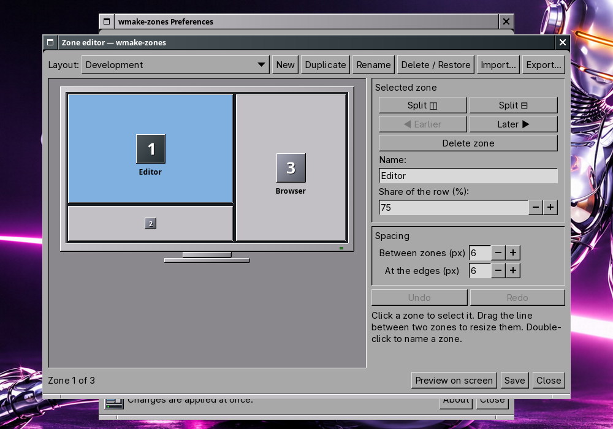

# Editor de zonas

`wmake-zones-prefs --editor [id]`, Super+Alt+Z, *Organização de janelas >
Editar zonas...* ou o botão nas preferências.

* O monitor desenhado tem a proporção do monitor principal.
* **Clique** numa zona para selecioná-la; **duplo clique** vai ao nome.
* **Arraste a linha** entre duas zonas para mudar a proporção (o cursor
  muda sobre a divisória; mínimo de 4% para cada lado).
* **Dividir ◫ / ⊟**: se o pai já divide no mesmo sentido, a nova zona vira
  irmã (dividindo o peso); senão a zona vira uma divisão de duas.
* **Excluir zona**: as vizinhas ocupam o espaço (a árvore se simplifica).
* **◀ Antes / Depois ▶**: troca a ordem com a irmã, o que muda a numeração.
* **Nome** e **parte da fileira (%)** da zona selecionada.
* **Espaçamento**: entre as zonas e nas bordas da tela (valem para todos
  os layouts).
* **Desfazer/Refazer** (Ctrl+Z, Ctrl+Shift+Z), **Salvar** (Ctrl+S),
  **Prévia na tela** (o serviço mostra as zonas por 1,8 s).
* **Novo, Duplicar, Renomear, Excluir/Restaurar, Importar, Exportar**:
  layouts exportados são arquivos `.wzlayout` (INI com seções
  `[Layout id]`), importáveis em outra máquina.

O editor grava pelo mesmo `wz_ini_set` do serviço: comentários e chaves que
ele não conhece ficam no arquivo. Depois de salvar, o serviço (ou o wlmaker)
recebe `reload`.

## Limites atuais

Por zona, há nome e proporção. Margens por zona, cor, ícone, atalho e
comportamento quando ocupada não foram implementados; as regras por
aplicativo ficam na seção Regras das preferências.
